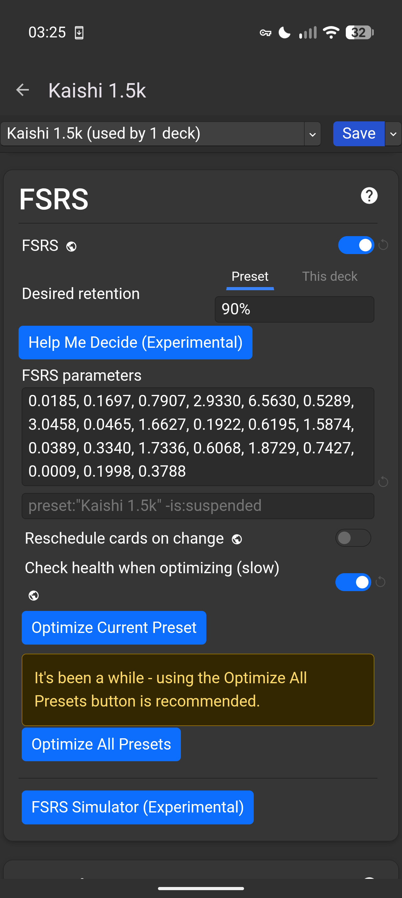
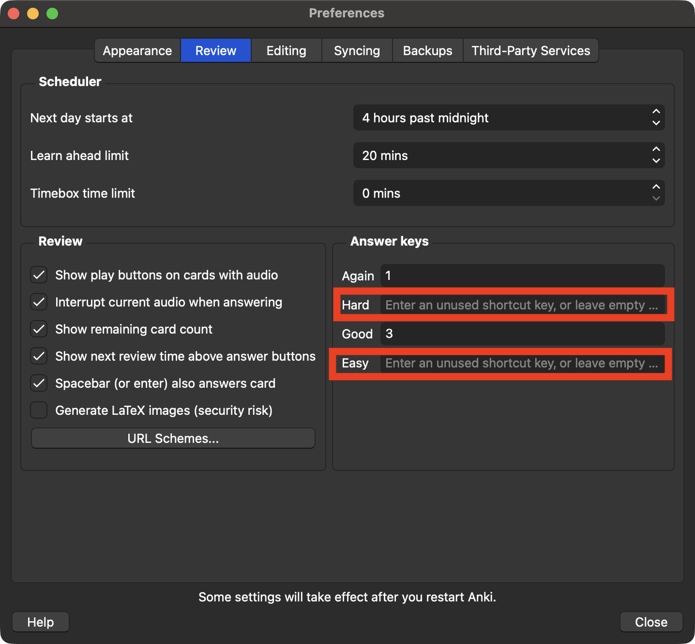
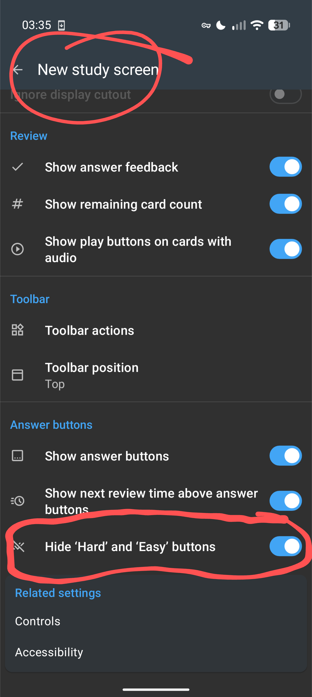
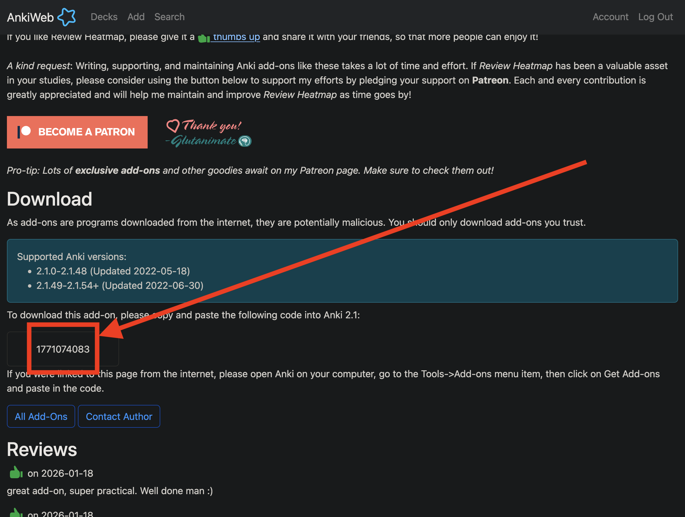

# Beginner's Japanese Learning Starterpack

Just a quick dump of some basic info for my mates, don't @ me (unless you're one of them lmao).

## Anki

Anki is an app for learning words and sentences via flashcards with its spaced repitition system (SRS).

- If you're on Windows, use [Anki for Windows from the download section on this page](https://apps.ankiweb.net/).
- For Android, use [AnkiDroid](https://play.google.com/store/apps/details?id=com.ichi2.anki).
- For iPhone, there's [AnkiMobile](https://apps.apple.com/us/app/ankimobile-flashcards/id373493387).

### Flashcard decks

To start with, the [Kaishi 1.5k vocabulary deck](https://ankiweb.net/shared/info/1196762551) will have you learning the most common 1,500 Japanese words. In the deck options, start with **5-10 new words per day**. Increase or decrease this number after a week or so to accomodate how much time you have available. Stick with it daily, but don't beat yourself up if you fall off the wagon.

**It is strongly recommended to never touch the Hard or Easy buttons during card reviews. To avoid accidental presses, follow the tweaks and add-ons guides below.**

### Tweaks

#### Improved learning algorithm with FSRS (highly recommended)

In the deck options, navigate to the **FSRS** section and enable it. Set it to 90% retention if you feel confident and want the quickest improvement, otherwise try 85% if you're pressed for time. Higher desired retention percentages increase your chances of retaining the vocab you learn, but come with an increased workload. I recommend 90% if you have the time as the long-term payoff is much greater. In the image below, ignore the **FSRS parameters** field (leave it empty); it will fill in automatically whenever you optimise the algorithm with the **Optimize All Presets** button (ideally pressed monthly). Remember to hit **Save** in the top right after enabling this setting!

#### Don't use Hard or Easy buttons to answer your flashcards

_We only want to use the **Again/Fail** (or **Good/Pass** with plugins) buttons when answering cards, so we'll remove the shortcut keys for the **Hard** and **Easy** buttons, and also use an add-on to hide the buttons from the interface (see **Recomennded add-ons** below to accomplish the latter)._

To remove the shortcut keys, open Anki's settings/preferences (unsure of where this is on Windows, but it'll likely be found in the top toolbar under **File** or some other related menu section).  Under the **Review** tab, blank out (delete the existing values of) the **Hard** and **Easy** shortcut fields under **Answer Keys**:

For AnkiDroid on Android (also enable the **New Study Screen** first):

_I don't use an iPhone so I'm unsure how to disable the **Hard** and **Easy** butons on AnkiMobile. If there is no such option, just avoid using the buttons._

### Install add-ons/plugins (Windows, macOS, Linux)

To install add-ons listed below, open the **Tools** menu in the top toolbar and click **Add-ons** (at least, that's what it is on macOS, I'm unsure about Windows). In the window that appears, click the **Get Add-ons...** button on the right and paste in the code found on the corresponding add-ons web page **(see image below)** and click the **OK** button to download and install the add-on. Restart Anki to load newly installed add-ons.

#### Recommended add-ons (Windows, macOS, Linux)

- [Pass/Fail 2: Remove the "Easy" and "Hard" buttons](https://ankiweb.net/shared/info/876946123)
- [Review Heatmap](https://ankiweb.net/shared/info/1771074083)

## Playlists

[Here's my playlist containing useful or motivational content](https://youtube.com/playlist?list=PLLic2BAB96fYbtHVjj4CSiBzrE5lpJYxt). I've made it so it can be watched in order of difficulty, with miscellaneous/difficult/motivational stuff hanging out toward the bottom.

## Podcasts

_(Note: Both podcasts below are available on Spotify which I recommend instead of using YouTube if you have Spotify Premium for smoothness and usability.)_

For picking up basic grammar, listen to the _[Learn Japanese with Masa sensei!](https://youtube.com/playlist?list=PLY94j5ZZrtXaV9ltU3OMEYi9cWNEIxZOX)_ podcast (remember to sort by **oldest**).

For beginner immersion content, I highly recommend _[Nihongo con Teppei](https://youtube.com/playlist?list=PLbsmSVzhiwvA8VNMAW_cuDqujRQULBjFd)_ (although, of course, you won't understand anything to start with, but it gets you used to the sounds and cadence of Japanese).
